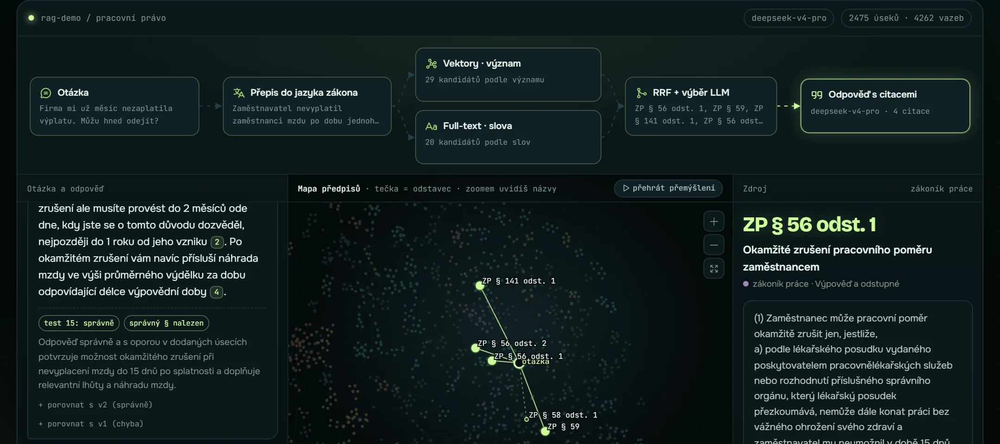

# RAG asistent nad pracovním právem

[English](README.md) · **Česky**

[](https://github.com/zenkovski/rag-demo/actions/workflows/tests.yml)

Odpovídá česky na otázky z pracovního práva. Odpovídá jen z textu zákona, každou odpověď ocituje a když odpověď v zákoně není, řekne „nevím“.

*Czech RAG assistant over 4 labour-law acts (2,475 paragraphs): hybrid search, LLM reranking, cited answers, measured on 66 hand-checked questions.*

**Živě: [lukas-rag.vercel.app](https://lukas-rag.vercel.app)**



## Co to umí

- Prohledá **4 předpisy, 2 475 odstavců**: zákoník práce, zákon o zaměstnanosti, zákon o nemocenském pojištění a nařízení o překážkách v práci.
- U odpovědi cituje konkrétní odstavce. Klik na citaci ukáže původní text.
- Mapa předpisů ukáže, jak asistent hledal: každá tečka je odstavec, nalezené svítí.
- U nejasné otázky se doptá („mzda, nebo plat?“) nebo odpoví pro každou variantu.
- Chyby neschovává. U každé chyby web ukáže, kde vznikla: v **hledání**, nebo ve **čtení**.

> Není to právní porada. Je to technická ukázka.

## Výsledky

> **Nové (16. 10. 2026): 134 netknutých otázek** (sady v4 + v5, zamčené v gitu před spuštěním). Správný odstavec mezi 5 u 111 ze 112, správná odpověď u 108 ze 112, správné „nevím“ u 21 ze 22. V tomto běhu dělal kroky s jazykovým modelem Claude Sonnet se stejnými prompty, ne DeepSeek. Podrobně anglicky: [docs/evaluation-v5.md](docs/evaluation-v5.md). Tabulka níže je starší měření na 66 otázkách.

Odpovědi hodnotí AI soudce (DeepSeek). Každou pak ještě jednou porovná s textem zákona Claude Opus 5.5 a já jsem výsledky prošel a schválil. Platí ten druhý verdikt.

| Co měřím | Výsledek |
|---|---|
| Otázky 57–66: napsané před spuštěním finální verze a od té doby netknuté (skutečný test) | **10 z 10** (95% interval 0,72–1,00) |
| Otázky 47–66 (u 47–56 se podle chyb ještě ladilo, viz [metodika](docs/cs/evaluation-methodology.md#2-dev-validation-test-a-prevence-úniku)) | 20 z 20 (předchozí verze 18 z 20) |
| Ukázkové otázky mimo testy | **14 z 16** (obě chyby jsou vidět na webu) |
| Past: odpověď v zákonech není, správně je „nevím“ | **10 z 10** |
| Správný paragraf mezi 5 úseky, které model dostane | **56 z 56** (cross-encoder pro srovnání 52, viz [DESIGN.md](docs/cs/DESIGN.md#5-výběr-5-z-20-llm-nebo-cross-encoder)) |

Celkem 66 z 66, ale toto číslo je nadsazené: podle většiny otázek se ladilo. Poctivé jsou řádky výše a **ty jsou malé** (8 a 10 otázek). Proto je napsaná a zmrazená nová sada 24 otázek, zatím nespuštěná ([proč a jak](docs/cs/evaluation-methodology.md)). Podrobně: [RESULTS.md](RESULTS.md).

## Jak to funguje

```
otázka
  → přepis do jazyka zákona            („výplata“ → „mzda“)            deepseek-v4.1-flash
  → hledání podle významu + podle slov (e5-large + BM25, spojení RRF) → 20 kandidátů
  → LLM vybere 5 úseků                 (+ odstavec 1 a odkazované odstavce téhož §)
  → odpověď jen z těchto 5, s citacemi                                 deepseek-v4-pro
```

Stejné hledání je napsané třikrát: ručně v Pythonu, v LangChainu a v JavaScriptu na webu. Všechny tři vrací stejných 5 úseků u 66 z 66 otázek.

## Měření, bezpečnost a provoz
Související: [**qa-portfolio**](https://github.com/zenkovski/qa-portfolio), automatizované testy webu a API (Playwright, 4 prohlížeče, přístupnost, bezpečnost, CI), stejný přístup k měření a ke spolehlivosti testů.


Kromě řetězce má projekt **měřicí laboratoř**, která odpovídá na otázku „co ze systému opravdu pomáhá a kde selhává?“. Vše běží offline z uložených výsledků, **zdarma a opakovatelně**.

| Co | Výsledek (podrobně a s intervaly: [benchmark-results.md](docs/cs/benchmark-results.md)) |
|---|---|
| **Výběr 5 z 20 přes LLM** je jediná komponenta s průkazným přínosem | Recall@1 0,54 → 0,85, MRR 0,71 → 0,96; lepší u 9 otázek, horší u 0 (p = 0,004) |
| **BM25 hledání nezlepšilo** | RRF bez BM25 má Recall@5 0,88, s BM25 0,86 (neprůkazné). Sada nemá otázky na přesné odkazy, kde má BM25 vyhrát → [ADR-004](docs/cs/decisions/ADR-004-prepis-a-bm25-otevrena-otazka.md) (otevřené) |
| LLM výběr × cross-encoder | 56 proti 52 z 56, ale p = 0,125: směr, ne důkaz |
| Kontrola citací a čísel bez LLM | našla špatnou citaci, kterou AI soudce přehlédl |
| Čas výpočtu hledání (bez sítě) | p50 ≈ 7 ms, p95 ≈ 10 ms. Odezva celé služby **není změřená** |

Kde se řetěz přerušil, říká [galerie chyb](docs/cs/failure-gallery.md): A nenalezeno · B vyřazeno · C špatně přečteno · D bez opory · E měl odmítnout · F zbytečné „nevím“. Včetně **dvou chyb, které na webu zatím zůstávají** (např. výpověď v nemoci).

| Dokument | O čem |
|---|---|
| [docs/implementation-plan.md](docs/cs/implementation-plan.md) | audit výchozího stavu, plán, co je hotové a co ne |
| [docs/architecture.md](docs/cs/architecture.md) | schémata řetězce a měřicí vrstvy |
| [docs/evaluation-methodology.md](docs/cs/evaluation-methodology.md) | dev / validation / test, prevence úniku, metriky a jejich meze |
| [docs/benchmark-results.md](docs/cs/benchmark-results.md) | výsledky ablací (generované) |
| [docs/failure-gallery.md](docs/cs/failure-gallery.md) | skutečná selhání: příčina, oprava, důkaz |
| [security/threat-model.md](docs/cs/security/threat-model.md) | aktiva, hrozby, obrany, co není ověřeno |
| [docs/decisions/](docs/cs/decisions/) | 6 rozhodnutí (ADR), jedno z nich otevřené |
| [docs/incidents/](docs/cs/incidents/) | incidenty od příznaku po důkaz opravy |
| [docs/limitations.md](docs/cs/limitations.md) | co chybí a proč (agent, load test, dělení textu…) |
| [docs/ai-assisted-development.md](docs/cs/ai-assisted-development.md) | kdo co ověřil a kde se AI spletla |

**CI** (GitHub Actions) má tři brány: lint + typy, testy (unit, bezpečnost, vykreslení webu), a **quality gate**, který přehraje hledání a porovná pořadí správných úseků po otázkách s referenčním stavem. Gate hlídá **kód hledání**, ne chování modelu (to by stálo peníze, viz [ADR-001](docs/cs/decisions/ADR-001-offline-quality-gate.md)).

## Soubory

| Soubor | Co dělá |
|---|---|
| `tools/chunk.py` | stáhne předpisy a rozdělí je na odstavce (`ZP § 56 odst. 1`) |
| `tools/rag.py` | celý postup: embeddingy, BM25, RRF, výběr, odpověď |
| `tools/rag_langchain.py` | stejný postup v LangChainu (LCEL) |
| `tools/evaluate.py` | měření na 66 otázkách → `RESULTS.md` |
| `tools/stats.py` | co lidi na webu hledali (anonymní záznam v Upstash Redis) |
| `tools/rerank_compare.py` | výběr přes LLM proti cross-encoderu (zdarma, z cache) |
| `tools/experiments.py`, `replay.py`, `metrics.py` | ablace, metriky s intervaly, záznam o běhu, `--check` pro CI |
| `tools/diagnose.py`, `answer_checks.py`, `make_docs.py` | kategorie selhání, kontrola citací a čísel, generování dokumentů |
| `tools/security_checks.py`, `security_eval.py` | detektory a živá sada injekcí (nespuštěná) |
| `tools/run_heldout.py` | jednorázový běh na zmrazené sadě v4 (se zámkem) |
| `tools/build_data.py` | data a rozložení mapy pro web |
| `site/index.html` | web (jeden soubor, D3 mapa) |
| `site/api/ask.js` | serverová funkce pro vlastní otázky (Vercel) |
| `data/testset*.json`, `data/splits.json` | otázky se správnými odpověďmi a role sad (dev / validation / test) |
| `results/baseline.json` | referenční stav pro quality gate |
| `data/manual_review.json` | verdikty druhé kontroly |
| `tests/` | 100+ testů bez API: metriky, kontroly odpovědí, web = Python, bezpečnost (ask.js proti falešnému OpenRouteru, XSS, oprávnění, tajemství) |

Další dokumenty:
- [RESULTS.md](RESULTS.md): výsledky otázku po otázce.
- [HISTORY.md](docs/cs/HISTORY.md): co se změnilo ve v1 → v3.1 a proč.
- [DESIGN.md](docs/cs/DESIGN.md): každé rozhodnutí, proč padlo a co by chybělo do provozu.

## Služba pro programy a AI agenty (od 16. 10. 2026)

Stejné hledání je teď i jako služba: REST API (`tools/api.py`, FastAPI, Docker) a MCP server pro AI agenty (`tools/mcp_server.py`). Obojí volá jednu sdílenou vrstvu `tools/service.py`. Návod v angličtině: [README.md](README.md) a [docs/mcp.md](docs/mcp.md). Vysvětlení česky: [docs/explain-for-lukas.md](docs/explain-for-lukas.md).

## Spuštění

```bash
py -3.13 -m venv .venv
.venv/Scripts/python -m pip install -r requirements.txt
copy .env.example .env                                   # doplň OPENROUTER_API_KEY

.venv/Scripts/python tools/chunk.py                       # stáhne a rozdělí předpisy
.venv/Scripts/python tools/rag.py "Nezaplatili mi výplatu, můžu odejít?"
.venv/Scripts/python tools/evaluate.py                    # měření -> RESULTS.md
.venv/Scripts/python tools/rag_langchain.py --compare     # LangChain = stejné výsledky?
.venv/Scripts/python tools/build_data.py                  # data pro web (~3 min)
.venv/Scripts/python -m pytest tests                      # testy (bez API, zdarma)
.venv/Scripts/python tools/experiments.py                 # ablace a metriky, offline, 0 $ -> docs/benchmark-results.md
.venv/Scripts/python tools/experiments.py --check --no-base   # to, co dělá CI: srovnání s results/baseline.json
.venv/Scripts/python -m ruff check . ; .venv/Scripts/python -m mypy
```

## Ochrana webu

Podrobně: [security/threat-model.md](docs/cs/security/threat-model.md) (14 hrozeb, co je ověřeno testem a co ne).

- API klíč je jen v proměnné prostředí na Vercelu a v lokálním `.env` (v `.gitignore`).
- Max 10 otázek na IP za den. Prohlížeč musí vyřešit proof of work (malý výpočet, 1–3 s), aby roboti nemohli posílat hromadné dotazy.
- Klíč má v OpenRouteru pevný limit 0,75 $. Celý projekt stál asi 0,66 $.

## Omezení

Úplný seznam: [docs/limitations.md](docs/cs/limitations.md).

- Dvě ze 16 ukázkových otázek na webu jsou špatně, nejhorší je „Může mi zaměstnavatel dát výpověď, když jsem nemocný?“ (příčina změřená, oprava zatím není). [Galerie chyb](docs/cs/failure-gallery.md#otevřené-chyby-zatím-neopravené).
- Oprava počítadla kliků (`hit.js`) je od 16. 10. 2026 nasazená na živém webu.
- Nová sada otázek (24, zmrazená) **ještě nebyla spuštěna**; do té doby je skutečně netknutých jen 10 otázek.
- Živé otázky na webu nikdo nekontroluje. Model se může splést, proto jsou u odpovědí citace.
- Asistent nezná výši minimální mzdy. Nařízení 567/2006 je zrušené a výši teď vyhlašuje ministerstvo sdělením.
- Počítadla limitů jsou v paměti funkce, ne v databázi.
- Zákony se mění. Data jsou zmrazená k 6. 10. 2026. Pro demo automatická aktualizace není potřeba. Jak by fungovala v provozu: [DESIGN.md](docs/cs/DESIGN.md#11-co-by-chybělo-do-provozu).

## Zdroje a autorství

Předpisy ze zakonyprolidi.cz, stažené 6. 10. 2026 (262/2006, 435/2004, 187/2006, 590/2006 Sb.). Text zákonů není chráněn autorským právem.

Postaveno s Claude Code (Opus 5.5). Kód napsala AI. Já jsem řídil, co se staví, nechal kód prověřit code-review skilly a dalšími review agenty, testoval a hlídal výsledky měření.
