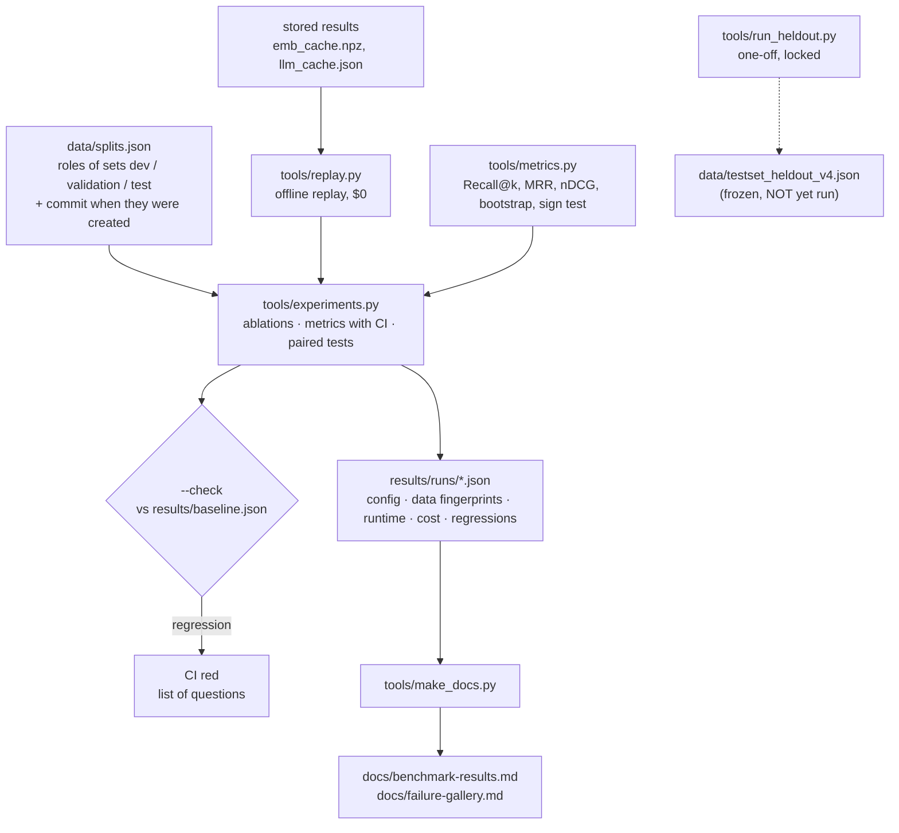

[Česky](cs/architecture.md)

# Architecture

One retrieval-augmented chain over 4 Czech regulations (2 475 paragraphs) and a **measurement layer** that can answer the question "why did it fail and did the fix help?".
Deliberately small: one Python module for the chain, one set of scripts for measurement, one serverless function for the website. What is **not** here (an agent, multiple users, a queue, a vector database) is in [limitations.md](limitations.md), with the reason.

Abbreviations: ZP = Labour Code, ZZ = Employment Act, ZNP = Sickness Insurance Act, NV 590 = Government Decree 590/2006.

## 1. The answer chain

```mermaid
flowchart LR
  Q[question] --> RW["rewrite into the language of the law<br/>(LLM, flash)"]
  Q --> D1["meaning: e5-large<br/>original question"]
  RW --> D2["meaning: e5-large<br/>rewritten question"]
  RW --> B["words: BM25<br/>rewritten question"]
  D1 & D2 & B --> F["RRF fusion<br/>→ 20 candidates"]
  F --> R["pick 5 of 20<br/>(LLM, flash)"]
  R --> P["fixed rules without AI<br/>+ paragraph 1, + referenced paragraphs"]
  P --> A["answer from 5 chunks<br/>with citations [n] (LLM, pro)"]
  A --> V["check: citations in range,<br/>numbers in the chunks"]
  V --> O[answer / "I don't know"]
```

| Step | Where | What it does | What can go wrong (categories in the [failure gallery](failure-gallery.md)) |
|---|---|---|---|
| rewrite | `rag.rewrite` | „výplata“ → „mzda“ ("pay" → "wage") | the rewrite leads the search elsewhere (A) |
| search | `rag.dense_scores`, `rag.bm25_scores`, `rag.rrf` | meaning + words, fusion of rankings | the correct paragraph is not among the 20 (A) |
| selection | `rag.rerank` | LLM picks 5 of 20 | drops the correct paragraph (B) |
| rules | `rag.with_odst1`, `rag.with_refs` | an exception gets its base rule, a reference is looked up | – (deterministic, tested) |
| answer | `rag.answer` | only from 5 chunks, citations, "I don't know" | misread (C), claim without support (D), should not have answered (E), needless "I don't know" (F) |
| check | `tools/answer_checks.py` | citations in range, numbers in the cited chunk | **only in measurement, not in the live chain** (see limitations) |

Every step can be switched off and measured separately (`rag.MODES`), so for every error you can say **where the chain broke**.

## 2. Three copies of the search (and why)

Python (`tools/rag.py`, this is what is measured), JavaScript (`site/api/ask.js`, runs on the website as a serverless function) and LangChain (`tools/rag_langchain.py`, a framework demonstration).
The risk of three copies is that they drift apart. This is prevented by the test `test_web_matches_python` (JS and Python give the same ranking) and the LangChain parity check (`rag_langchain.py --compare`). The decision and its cost: [DESIGN.md §9](../DESIGN.md#9-why-the-retrieval-is-written-three-times).

## 3. The measurement layer



Two measurements are **deliberately separate**:
- **Offline replay** (CI, free): verifies that the search CODE has not changed. Bit-for-bit repeatable.
- **Live measurement** (`tools/evaluate.py`, `tools/run_heldout.py`, `tools/security_eval.py`): verifies the MODEL'S BEHAVIOUR. It costs money, is not deterministic, is run by hand and is recorded in documents.

Why: see [ADR-001](decisions/ADR-001-offline-quality-gate.md).

## 4. Website and protection

`site/index.html` (a single file, D3 map), `site/api/ask.js` (live question: proof of work, 10 questions per IP, budget on the key), `site/api/hit.js` (click counter, prepared questions only). Threats and defences: [security/threat-model.md](../security/threat-model.md).

## 5. Versions that can be traced

| What | Where the version is |
|---|---|
| Code | git commit in the run record |
| Data and sets | file fingerprints in the run record (`datasets`) |
| Models | `config` in the run record (embedding, rewrite/selection, answer) |
| Prompts | `prompt_hashes` fingerprints in the run record |
| Roles of sets | `data/splits.json` (commit when the set was created) |

**Returning to an older configuration:** git (`git checkout <commit> -- tools/rag.py data/`) and comparing `results/baseline.json`. Indexes are not versioned separately, because the embeddings are derived from `data/chunks.json` and a cache keyed by text content; a different embedding model = a new cache (costs API calls).
Not implemented: named configuration versions with a runtime switch.
